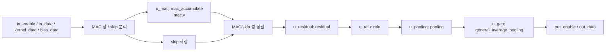

# Core 내부 구조

첨부의 포트와 파일 배치를 기준으로 구현했습니다. 이전 ready/valid 명령형 SIMD 설계와 다른 버전입니다.
core에는 레이어 순서·주소·DMA Controller를 구현하지 않습니다.



모듈은 enable=0이면 우회합니다. MAC을 끄면 core의 residual도 우회합니다.
별도 skip 포트가 없으므로 Residual은 MAC 항과 후속 skip의 묶음 규약으로 사용합니다.

## 함수와 수치

| 위치 | 함수 / 연산 |
|---|---|
| mac.v / mac_accumulate | `round_shift()` → `saturate()` |
| residual.v | `saturate(main + skip)` |
| relu.v | 부호 비트 검사. 함수 없이 레지스터에 저장 |
| pooling.v | 첫 항 채택 후 signed max. 함수 없음 |
| general_average_pooling.v | `round_mean(sum, N)` |

```text
MAC: bias × 2^FRAC_W + Σ(feature × weight)
       → round_shift(): /2^FRAC_W, 최근접 반올림
       → saturate(): signed BITWIDTH 범위 제한
Residual: saturate(MAC 결과 + skip)
ReLU: enable이면 max(value, 0)
Pool: N개 유효 입력의 signed max
GAP: round_mean(): Σ입력/N, 입력과 같은 Q scale
```

기본 FRAC_W=10이며 bias와 feature는 Q5.10, 곱/누산은 소수부 20비트 단위입니다.
bias는 **첫 MAC 항에서만** 사용합니다. 두 번째 이후의 bias_data는 무시합니다.
반올림의 정확한 절반은 0에서 먼 방향으로 처리합니다. 음수 최솟값도 확장 절댓값으로 처리합니다.
MAC 포화와 Residual 포화는 각 단계에서 수행합니다. 따라서 `sat(MAC)+skip` 뒤 포화이며 fused 연산과 다를 수 있습니다.

기본 MAC 누산 폭은 `2*BITWIDTH + BITWIDTH_MAC_ITERATION = 48`비트,
GAP 합 폭은 `BITWIDTH + BITWIDTH_GAP_ITERATION = 32`비트입니다.
`mac`은 기존 bias 없는 단독 포트를 유지하는 wrapper이며 core는 같은 파일의 `mac_accumulate`를 인스턴스합니다.

## 시간 순서

각 모듈은 pending → output 두 레지스터를 사용합니다.
유효 입력을 상승 에지 E0에 수집하면 해당 단계 출력은 E1 직후 유효해지고,
다음 모듈은 E2 상승 에지에서 수집합니다.

우회만 할 때 E0 입력은 core 출력에 E9 직후 나타나고 외부는 E10에서 소비합니다.
MAC은 첫 항이 아닌 **마지막 항**부터 이 출력 경로를 시작합니다.
Pool/GAP는 N번째 실제 유효 입력이 들어올 때만 결과를 만듭니다.
입력 bubble은 반복 횟수에 포함하지 않으며, 출력값은 out_enable=1일 때만 해석합니다.

Residual 활성 시 마지막 MAC 항 이후의 다음 유효 입력은 skip입니다.
MAC 결과와 skip 중 먼저 도착한 값을 저장하고 둘이 준비된 에지에 residual로 전달합니다.
skip 지연이 달라지면 전체 지연도 변하므로 외부는 out_enable과 예상 출력 수를 기준으로 완료를 판단합니다.

## 외부 Controller가 지킬 사항

1. 설정 변경 전 이전 결과를 모두 수신하고 pipeline을 비웁니다. 미완성 작업 취소는 nrst를 사용합니다.
2. MAC 항 N개 뒤에 skip 1개를 넣습니다. skip과 main의 위치·채널·Q scale은 외부가 맞춥니다.
3. Pool 창과 GAP의 동일 채널 공간 입력을 외부에서 묶어 순서대로 공급합니다.
4. ready가 없으므로 모든 유효 출력을 받을 버퍼를 준비합니다.
5. nrst는 비동기 active-low이며 reset 해제 동기화는 상위에서 수행합니다.

## 자원과 구현 제한

실제 곱셈기는 단일 lane입니다. PARALLEL_PC/PF를 바꾸기만 해서 16 MAC이 되지 않습니다.
다른 병렬값은 elaboration 오류로 거부하며, 확장에는 데이터 버스/weight 공급 규약 변경이 필요합니다.

GAP는 첨부 valid-only 포트의 연속 입력과 2단계 지연을 유지하기 위해 폭을 제한한 **조합 나눗셈**을 사용합니다.
임의 양수 N을 지원하지만 자원과 critical path를 Vivado에서 확인해야 합니다.
이번 버전에는 순차 divider나 입력 backpressure를 추가하지 않았습니다.
합성 목표 100MHz는 달성 보장이 아닙니다. OOC 결과는 외부 I/O/reset 제약을 완성한 보드 timing signoff가 아닙니다.
