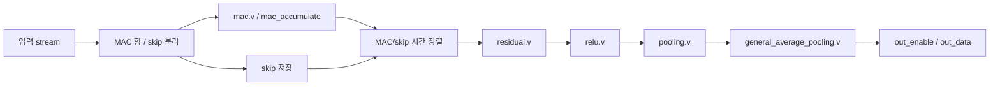

# 기본 ResNet-20 core

이 문서는 제공된 core의 규약입니다. 공통 실행기의 사용과 다른 모듈 교체는 [가이드](GUIDE.md)를 보십시오.



| 파일 | 기능 |
|---|---|
| rtl/compute/core.sv | 연산 모듈 연결과 MAC/skip 정렬 |
| mac.v | 곱셈/누산, 첫 항 bias, `round_shift()`와 `saturate()` |
| residual.v | main+skip 합과 `saturate()` |
| relu.v | 음수 제거 / 우회 |
| pooling.v | N개 유효 입력의 signed 최대값 |
| general_average_pooling.v | 합 수집과 `round_mean()` |

기본 단일 lane·INT16·Q5.10, MAC 누산 48-bit, GAP 합 32-bit입니다.
PARALLEL_PC/PF는 1만 지원합니다. 변경만으로 병렬 MAC이 늘어나지 않습니다.
네트워크는 BasicBlock 기반 ResNet-20이며, core는 MAC 항 수를 바꾸어 Conv/FC에 재사용합니다.
Controller·메모리·AXI/DMA·레이어 순서는 core에 포함하지 않습니다.

## 입력과 출력

- in_enable=1인 매 상승 에지에 입력을 수신합니다. ready/done 포트는 없습니다.
- 설정은 첫 입력 전부터 모든 결과가 배출될 때까지 유지합니다.
- mac_iteration=N이면 N쌍의 feature/weight를 넣습니다. bias는 첫 항에서만 적용합니다.
- residual 활성 시 마지막 MAC 항 다음 유효 in_data 한 개가 skip입니다. 이 항은 MAC에 넣지 않습니다.
- skip/main의 위치·채널·Q scale은 외부에서 맞춥니다. 도착 시간 차이는 core가 보관해 정렬합니다.
- 각 단계는 enable=0이면 우회합니다. MAC 비활성 시 core의 residual도 우회합니다.
- Pool은 같은 창, GAP는 같은 채널의 공간 값을 순서대로 공급합니다.
- 활성 반복값 0은 해당 단계 입력을 폐기하고 부분 그룹을 지웁니다. 정상 작업은 1 이상입니다.
- nrst는 비동기 active-low입니다. 출력은 out_enable=1일 때 반드시 수신합니다.

## 수치와 지연

```text
MAC: (bias << 10) + Σ(feature × weight)
     → /1024 반올림 → INT16 포화
Residual: MAC의 포화 결과 + skip → INT16 포화
ReLU: max(value, 0)
GAP: Σ입력/N 반올림, 입력과 같은 Q scale
```

정확한 절반은 0에서 먼 방향으로 반올림합니다. MAC과 Residual의 포화는 각 단계에서 수행합니다.
각 단계는 pending→output 두 레지스터입니다. 전부 우회하면 E0 입력은 E9 직후 core 출력에 나타나고 E10에서 소비합니다.
MAC은 마지막 항, Pool/GAP는 N번째 실제 수신에서 결과를 만듭니다. skip 지연에 따라 전체 지연이 추가될 수 있습니다.
입력 공백은 반복 횟수에 포함하지 않습니다. 설정 변경 전 pipeline을 비우며 중간 취소는 reset을 사용합니다.

GAP는 valid-only 연속 입력과 2단계 지연을 위해 폭을 제한한 조합 나눗셈을 사용합니다.
자원과 critical path는 Vivado에서 확인해야 합니다.

## 제공 데이터 검사

기본 tb_core는 22개 연산 레이어 정수 정답을 비교하고 최종 로짓 SNR>=50dB를 검사합니다.
입력은 CIFAR-10 크기 32×32×3의 결정적 패턴 하나이며 실제 CIFAR-10 분류 정확도 평가가 아닙니다.
가중치 형식은 [weight.bin 사양](../verification/resnet20/weight_bin_spec.md)에 있습니다.
