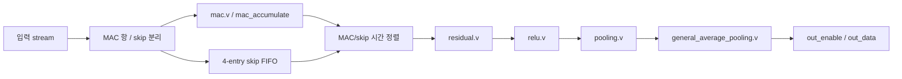

# ResNet-20 core 1.1.0

이 문서는 제공된 core의 규약입니다. 공통 실행기의 사용과 다른 모듈 교체는 [가이드](GUIDE.md)를 보십시오.



| 파일 | 기능 |
|---|---|
| rtl/compute/core.v | 연산 모듈 연결과 MAC/skip 정렬 |
| mac.v | mac wrapper와 mac_accumulate: 곱셈 → 누산 → 절댓값 → 반올림 → 포화/부호 복원 |
| residual.v | main+skip 합과 `saturate()` |
| relu.v | 음수 제거 / 우회 |
| pooling.v | N개 유효 입력의 signed 최대값 |
| general_average_pooling.v | 합 수집 → 절댓값 → 반올림/shift → 부호 복원 |

기본 단일 lane·INT16·Q5.10, MAC 누산 48-bit, GAP 합 26-bit입니다. GAP 합 폭은 BITWIDTH+log2(MAX_GAP_ITERATION)입니다.
PARALLEL_PC/PF는 1만 지원합니다. 변경만으로 병렬 MAC이 늘어나지 않습니다.
네트워크는 BasicBlock 기반 ResNet-20이며, core는 MAC 항 수를 바꾸어 Conv/FC에 재사용합니다.
Controller·메모리·AXI/DMA·레이어 순서는 core에 포함하지 않습니다.

## 입력과 출력

- in_enable=1인 매 상승 에지에 입력을 수신합니다. ready/done 포트는 없습니다.
- 설정은 첫 입력 전부터 모든 결과가 배출될 때까지 유지합니다.
- mac_iteration=N이면 N쌍의 feature/weight를 넣습니다. bias는 첫 항에서만 적용합니다.
- residual 활성 시 마지막 MAC 항 다음 유효 in_data 한 개가 skip입니다. 이 항은 MAC에 넣지 않습니다.
- skip/main의 위치·채널·Q scale은 외부에서 맞춥니다. 도착 시간 차이는 core가 보관해 정렬합니다.
- 각 단계는 enable=0이면 우회합니다. MAC 비활성 시 core의 residual도 우회합니다.
- Pool은 같은 창, GAP는 같은 채널의 공간 값을 순서대로 공급합니다.
- 활성 반복값 0은 해당 단계 입력을 폐기하고 부분 그룹을 지웁니다.
- MAC/Pool의 반복값은 포트 범위 내 양수입니다. GAP는 기본 N=1,2,4,8,16,32,64,128,256,512,1024만 지원합니다.
- GAP의 비지원 N도 입력 폐기/부분 그룹 초기화입니다. 기존 파이프라인의 완료 결과는 배출됩니다.
- MAX_GAP_ITERATION은 core와 GAP의 파라미터이며 양의 2의 거듭제곱으로 설정합니다. iteration 포트로 표현 가능한 값이어야 합니다.
- 데이터 레지스터 일부는 reset하지 않습니다. reset 중/valid=0일 때 out_data는 의미가 없고 X일 수 있습니다.
- nrst는 비동기 active-low입니다. 출력은 out_enable=1일 때 반드시 수신합니다.

## 수치와 지연

```text
MAC: (bias << 10) + Σ(feature × weight)
     → /1024 반올림 → INT16 포화
Residual: MAC의 포화 결과 + skip → INT16 포화
ReLU: max(value, 0)
GAP: N=2^k, sign(sum) × ((abs(sum) + (N/2)) >> k)
     N=1이면 보정값 0, 입력과 같은 Q scale
```

정확한 절반은 0에서 먼 방향으로 반올림합니다. MAC과 Residual의 포화는 각 단계에서 수행합니다.

| 블록 | 레지스터 단계 | 마지막 입력 E0 기준 유효 출력 |
|---|---:|---|
| MAC / mac_accumulate | 5 | E4 직후 |
| Residual | 2 | E1 직후 |
| ReLU | 2 | E1 직후 |
| MaxPool | 2 | E1 직후 |
| GAP | 4 | E3 직후 |

각 블록 우회도 같은 단계 수를 지납니다. core 전체 우회는 E0 입력 → E14 출력이며 다음 상승 에지 E15에서 소비합니다.
MAC 마지막 항이 L, skip 수신이 S이고 Pool/GAP 우회라면 core 출력은 다음과 같습니다.

- residual 비활성: L+14 직후
- residual 활성: max(L+5,S)+9 직후

MAC은 마지막 항, Pool/GAP는 N번째 실제 수신을 기준으로 합니다. 입력 공백은 반복 횟수에 포함하지 않습니다.
설정 변경 전 모든 결과를 받고 pipeline을 비웁니다. 중간 취소는 reset을 사용합니다.

```text
MAC: S0 s0_product / 그룹 경계
  → S1 accumulator / s1_sum
  → S2 s2_magnitude / s2_negative
  → S3 s3_rounded / s3_negative
  → S4 out_data / out_enable

GAP: S0 accumulator / s0_sum / s0_shift
  → S1 s1_magnitude / s1_negative / s1_shift
  → S2 s2_rounded / s2_negative
  → S3 out_data / out_enable
```

먼저 도착하는 skip은 4-entry FIFO에 저장하고, 늦은 skip을 기다리는 MAC 결과는 별도 1개 레지스터에 저장합니다.
N=1의 연속 MAC/skip 쌍과 늦은 skip 모두 입력 순서를 보존합니다. FIFO 용량은 현재 MAC 5단계에 맞춰 설계되었습니다.
후속 구현에서 MAC 지연을 더 늘리면 FIFO 깊이와 core 정렬도 다시 검토해야 합니다.

GAP에는 나눗셈 연산자가 없습니다. 반올림과 shift를 별도 단계에서 수행합니다.
실제 자원과 critical path는 Vivado 배치배선 결과로 확인해야 합니다.

## 제공 데이터 검사

기본 tb_core는 22개 연산 레이어 정수 정답을 비교하고 최종 로짓 SNR>=50dB를 검사합니다.
입력은 CIFAR-10 크기 32×32×3의 결정적 패턴 하나이며 실제 CIFAR-10 분류 정확도 평가가 아닙니다.
가중치 형식은 [weight.bin 사양](../verification/resnet20/weight_bin_spec.md)에 있습니다.
