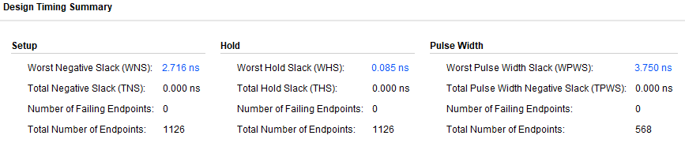
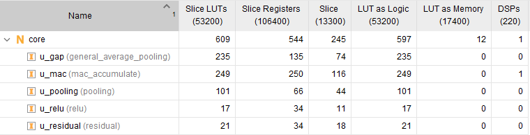

# 1.1.0 배치·배선 후 리포트

[전체 버전 비교](../README.md) · [waveform 가이드](../../docs/ANALYSIS.md)

사용자 제공 이미지 기준, 10ns(100MHz), 모듈 OOC post_route 결과입니다. 6개 분석 top 모두 표시된 Setup/Hold/Pulse Width 위반이 없습니다.

## Timing

단위 ns. Setup/Hold/Pulse 위반 수는 failing endpoints입니다.

| top | WNS | TNS | Setup 위반 | WHS | THS | Hold 위반 | WPWS | TPWS | Pulse 위반 |
|---|---:|---:|---:|---:|---:|---:|---:|---:|---:|
| core | +2.716 | 0.000 | 0 | 0.085 | 0.000 | 0 | 3.750 | 0.000 | 0 |
| MAC (mac top) | +5.073 | 0.000 | 0 | 0.144 | 0.000 | 0 | 4.500 | 0.000 | 0 |
| Residual | +8.424 | 0.000 | 0 | 0.159 | 0.000 | 0 | 4.500 | 0.000 | 0 |
| ReLU | +8.575 | 0.000 | 0 | 0.098 | 0.000 | 0 | 4.500 | 0.000 | 0 |
| MaxPool | +4.808 | 0.000 | 0 | 0.169 | 0.000 | 0 | 4.500 | 0.000 | 0 |
| GAP | +4.090 | 0.000 | 0 | 0.147 | 0.000 | 0 | 4.500 | 0.000 | 0 |

## 단독 top 자원

`—`는 이미지에 보이지 않는 열입니다. Slice는 Slice 개수이며 Slice LUTs와 다릅니다.

| top | Slice LUTs | Slice Registers(FF) | Slice | LUT as Logic | LUT as Memory | DSP |
|---|---:|---:|---:|---:|---:|---:|
| core | 609 | 544 | 245 | 597 | 12 | 1 |
| MAC (mac top) | 174 | 186 | 79 | 174 | — | 1 |
| Residual | 36 | 34 | 13 | 36 | — | — |
| ReLU | 9 | 34 | 5 | 9 | — | — |
| MaxPool | 80 | 66 | 37 | 80 | — | — |
| GAP | 239 | 135 | 81 | 239 | — | — |

## core 내부 계층 자원

아래는 UT_core 이미지의 내부 행이며, 위 단독 모듈 측정값과 구분합니다.
`u_mac`은 bias를 받는 mac_accumulate입니다.

| 인스턴스 | Slice LUTs | FF | Slice | LUT as Logic | LUT as Memory | DSP |
|---|---:|---:|---:|---:|---:|---:|
| u_gap | 235 | 135 | 74 | 235 | 0 | 0 |
| u_mac | 249 | 250 | 116 | 249 | 0 | 1 |
| u_pooling | 101 | 66 | 44 | 101 | 0 | 0 |
| u_relu | 17 | 34 | 11 | 17 | 0 | 0 |
| u_residual | 21 | 34 | 18 | 21 | 0 | 0 |

## 원본 이미지

TR은 Timing Summary, UT는 Utilization입니다. 업로드된 원본 파일명을 유지했습니다.

| top | Timing 원본 | Utilization 원본 |
|---|---|---|
| core | [TR_1.1.0_core.png](TR_1.1.0_core.png) | [UT_1.1.0_core.png](UT_1.1.0_core.png) |
| MAC (mac top) | [TR_1.1.0_mac.png](TR_1.1.0_mac.png) | [UT_1.1.0_mac.png](UT_1.1.0_mac.png) |
| Residual | [TR_1.1.0_residual.png](TR_1.1.0_residual.png) | [UT_1.1.0_residual.png](UT_1.1.0_residual.png) |
| ReLU | [TR_1.1.0_relu.png](TR_1.1.0_relu.png) | [UT_1.1.0_relu.png](UT_1.1.0_relu.png) |
| MaxPool | [TR_1.1.0_pooling.png](TR_1.1.0_pooling.png) | [UT_1.1.0_pooling.png](UT_1.1.0_pooling.png) |
| GAP | [TR_1.1.0_gap.png](TR_1.1.0_gap.png) | [UT_1.1.0_gap.png](UT_1.1.0_gap.png) |

### core 원본

원본 RPT·제약파일·실행 SHA는 미첨부입니다. 상세한 [자료 범위](../README.md#자료-출처)를 확인하십시오.
